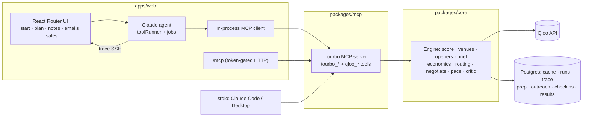

# Tourbo

> **The tour manager small acts can't afford.** Tell it who you are and where you want to play. Its agent finds where your fans actually live, picks the rooms, runs the money for every night, writes what to say on stage and handles the venue emails.

Qloo Agentic Hackathon 2026 entry. Live demo: _link added at deploy_.

Labels and promoters already route tours for big acts. A singer with a 300-person draw, or a comic playing bars, decides by gut: last tour's cities, streaming counts, a friend's advice. A wrong city is a half-empty room and a lost weekend's pay. Tourbo makes those calls with Qloo's taste and location data, explains each one, and then does the follow-up work.

**Who does what**

- **Qloo** knows taste: where an act's fans cluster (street-level heatmaps), which rooms and local acts those fans like, what each city loves, which local brands fit as sponsors.
- **Tourbo MCP server** (`packages/mcp`) turns that into tour tools: score cities, find rooms, openers, show economics, routing, promo split, offer assessment, ticket pace, plan critic. No AI inside; every number is reproducible.
- **Claude** is the agent. On the website it calls those tools in-process, weighs trade-offs, writes show notes and venue emails, and negotiates. In your own Claude Code or Claude Desktop, your Claude calls the same tools.
- **You** approve. Nothing goes to a venue without a click; every money figure is labelled an estimate.

## What a user gets (the stories in [`STORIES.md`](STORIES.md))

1. **Plan:** a five-step onboarding (`/start`): what you do → "is this you?" on Qloo, or acts you sound like → click the map and size a circle → dates, number of shows, room size, optional money limits → the jobs you want done. Claude then plans while a progress list shows each step.
2. **Tour:** a route on the map, and for each night the room, opener, deal, ticket price, expected tickets and profit. Nights that lose money are dropped or turned into support slots. A "why?" toggle shows the Qloo evidence.
3. **Show notes:** for every night, an opening line, setlist nods to local acts or local bit premises, banter, a crowd moment, room setup and a sponsor ask. A critic rejects any local reference that isn't in that city's Qloo brief and Claude revises. A Qloo-off draft sits alongside for contrast.
4. **Venue emails:** one inquiry per venue with the fan numbers. Replies are classified; a pass promotes the backup room. An offer is checked against your lowest fee and the planned show (deterministic), then Claude drafts an accept, a counter or a polite walk-away for you to send.
5. **Ticket sales:** enter tickets sold; Tourbo says whether the show is on track and what to do (shift promo, lean on the opener, smaller room, raise the price). After the show, log attendance; the next plan calibrates your draw from it.
6. **For venues** (`/explore`): a bar enters its name and gets acts its crowd likes, with local fans. Also "where do acts like me win?" across regions by comparable acts or genre (e.g. qawwali).
7. **Your own Claude** (`/connect`): open Claude Code in this repo and Tourbo's tools are there (`.mcp.json`); or add the stdio server anywhere; or use the token-gated hosted endpoint.

## Why it fails without Qloo

An LLM alone names "big music cities". It can't say where *this* act's fans cluster block by block, which rooms near them that crowd likes, which local acts share the audience, or what the city's audience loves right now. The "With vs without Qloo" tab shows the same model planning blind; the show-notes page shows the generic draft next to the grounded one.

## How it uses Qloo

One client (`packages/core/src/qloo/client.server.ts`): GET with `X-Api-Key`, retries on 429/5xx, concurrency 8, a per-type parameter whitelist (Qloo silently ignores unknown params) and a Postgres response cache (memory fallback).

| Job | Qloo call |
| --- | --- |
| Resolve act (strict name match; unknown acts plan from "sounds like" peers) | `/search` (`urn:entity:artist` / `urn:entity:person` for comedians) |
| City scores + fan hotspots | `/v2/insights` `urn:heatmap`, act + peer signal, `filter.location.query`, geohash boundary |
| Rooms | `urn:entity:place` near the top hotspot with place tags (live music, concert hall, club, bar, comedy club, theatre), act signal, widening search |
| Openers | similar artists / people no bigger than the act, ranked by local heatmap presence |
| City brief (show notes) | city culture via `signal.location.query` (TV, brands, people, podcasts), local artists, local spots weighted by the act's fans, fan tags |
| Sponsors | city brands re-ranked by the act's fans (`filter.results.entities`) |
| Markets for new acts | heatmaps from comparable acts or genre tags (`signal.interests.tags`) across regions |
| Acts for a venue | artists/people with the venue as the signal, plus local heatmap presence |

Plus the nine Qloo hackathon-harness workflows (recommend, rank, describe, where_popular, compare_audiences, entity_tags, audience_demographics, trends, find_tags), ported to TypeScript as `qloo_*` MCP tools.

## Architecture



- npm workspaces: `packages/core` (no LLM), `packages/mcp` (no LLM, stateless), `apps/web` (all inference).
- Agent: `@anthropic-ai/sdk` tool runner (Claude Haiku 5.5), adaptive thinking summaries in the trace, prompt caching, structured outputs for workers, show notes and email drafts. A full plan costs about $0.02; show notes about $0.004 per night.
- MCP: `@modelcontextprotocol/server` v2; progress notifications carry trace events so the hosted UI streams tool internals.
- Map: MapLibre GL + OpenFreeMap. Email: Resend (sandbox inbox only in the demo).

## Judging criteria

- **Technological implementation:** heatmaps, place/tag insights, cross-domain city taste, sponsor re-ranking and genre-tag markets through a validated, cached client; an MCP server reused by the hosted agent and by external agents; a tool-using agent with critic loops, deterministic economics, negotiation and pace models, and story tests against live Qloo.
- **Design:** onboarding in five plain steps, live progress, one card per night with the reasoning folded away, plain-language errors with retry.
- **Potential impact:** a real buyer (independent acts, small venues) and real money: which nights to play, what to charge, what to accept.
- **Quality of idea:** each decision needs Qloo's taste + location data, and the Qloo-off comparisons make that visible.

## Run locally

Node 22+ and Docker.

```bash
npm install
cp .env.example .env     # set QLOO_API_KEY and ANTHROPIC_API_KEY
npm run dev              # starts Postgres (docker compose) + http://localhost:3000
```

- `npm run test:stories`: the user stories against live Qloo (no LLM); `STORY_LLM=1` adds a full Claude run (app must be running).
- `npm run mcp`: the MCP server on stdio. `npm run test -w @tourbo/mcp`: MCP smoke test.
- `npm run plan:demo -- "<artist>" [na|eu|in] [shows] [musician|comedian]`: engine only. `npm run agent:demo -- …`: full agent in the terminal.
- Docker: `docker compose --profile app up -d --build web` runs the production image with Postgres.

| Variable | Required | Notes |
| --- | --- | --- |
| `QLOO_API_KEY` | yes | |
| `ANTHROPIC_API_KEY` | yes (website agent) | not needed for the MCP server |
| `DATABASE_URL` | no | default: the compose Postgres |
| `MCP_TOKENS` | no | comma-separated bearer tokens; enables `/mcp` |
| `PUBLIC_URL` | no | shown in the Connect page snippets |
| `RESEND_API_KEY`, `RESEND_WEBHOOK_SECRET`, `OUTREACH_*` | no | email; sends are simulated without a key |

## Limits

- Qloo has no capacity, price or sales data: capacities, draw and profit are estimates (formula shown on each card), calibrated once you log past shows.
- Demo disciplines: musicians and comedians. The model is designed to extend to dancers, poets, visual artists, authors and podcasters (PLAN §16).
- Runs are in-process: a restart mid-run shows "interrupted" with a retry button.

## License

MIT. Qloo responses are cached server-side only and never committed.
