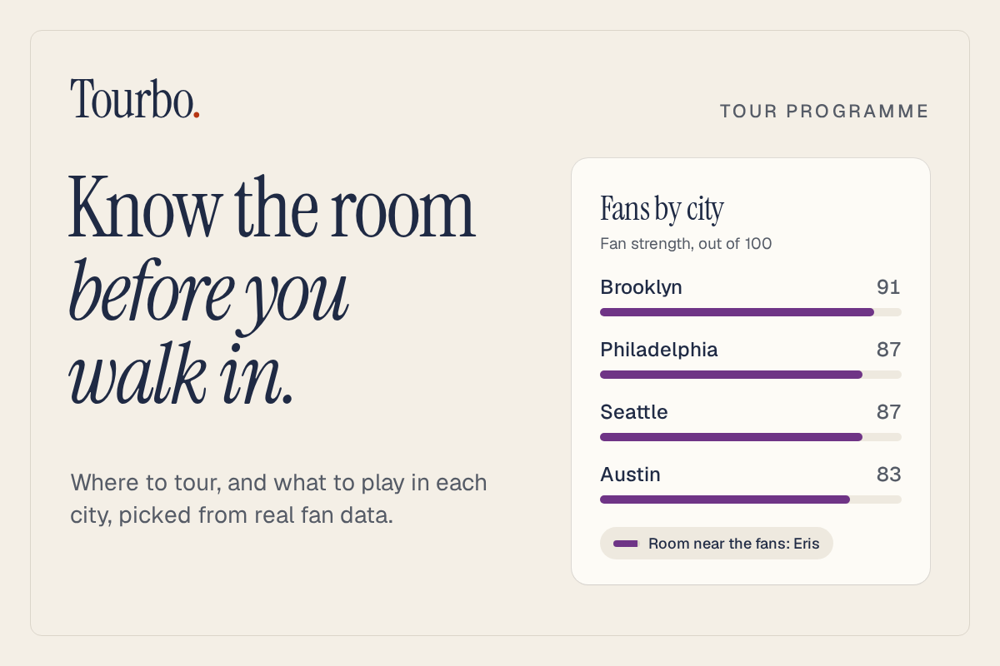
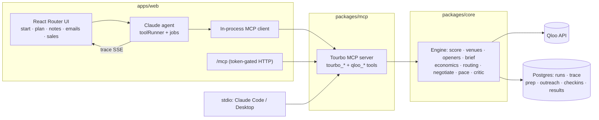

# Tourbo



**Know the room before you walk in.**

Tourbo helps touring artists plan where to play and what to play there. Tell it who you are and where you want to go. It finds the cities where your fans actually are, picks rooms you can fill, checks the money on every night and plans the route. Then, for each city, it suggests what to perform or make: the cover that crowd will sing back, the local topic that gets a laugh, the subject worth painting, the set order that lands.

Every suggestion comes with the fan data behind it. No guesses dressed up as advice.

**Try it:** [tourbo-30ec.onrender.com](https://tourbo-30ec.onrender.com/) · Built for the Qloo Agentic Hackathon 2026 · MIT licensed

---

## Why Tourbo

Every city is a different crowd, but most touring acts play the same set everywhere. Big acts have promoters and local crews who know what Austin wants versus Glasgow. A singer with a 300-person draw, or a comic working bars, just guesses. Ask a chatbot and you get "play a classic" or "joke about the traffic".

Tourbo gives you what a local would tell you, with the numbers to prove it. If your fans in Austin love AC/DC more than your fans anywhere else, Tourbo suggests an AC/DC song done your way, in Austin only.

## What you can do

- **Get ideas for each city.** Cover ideas for musicians, local topics and crowd-work questions for comics, subjects and themes for painters, and a set order for every night. Tap **why?** on any idea to see the numbers.
- **Plan the tour.** Click the map, pick dates and number of shows. You get a route, and for each night a room, a local opener, a ticket price and whether the night makes money. Nights that lose money get dropped or turned into support slots.
- **Prepare the show.** Opening lines, local nods and banter for each night, checked against that city's data, plus a rehearsal with simulated audience members.
- **Talk to venues.** Tourbo drafts the inquiry emails, checks offers against your lowest fee and drafts a reply: accept, counter or walk away. Nothing is sent until you click.
- **Track ticket sales.** Enter tickets sold and see if a show is on track.
- **Not in the fan data yet?** Most small acts aren't. Pick acts you sound like, a style, or just the city, and you still get ideas. The screen always says what they're based on.
- **Use it from your own AI assistant.** The same tools run as an MCP server for Claude Code, Claude Desktop, Cursor and other clients.

## How it works

1. **Qloo** knows taste: where your fans cluster, which artists they love more in one city than elsewhere, what each city is into (TV, teams, food, places, people, trends), and which rooms and local acts fit.
2. **The Tourbo MCP server** turns that into tools: score cities, find rooms and openers, work out the money, plan the route, check offers. No AI inside, so every number is reproducible.
3. **Claude** uses those tools to pick the best ideas and cities, and writes the short notes and emails on top. A critic drops any idea it can't match to that city's data.
4. **You** decide. Money figures are labelled as estimates, and nothing goes to a venue without your approval.

## Does the data help?

We checked Tourbo against eight real 2024–25 tours by mid-size acts. Tourbo's top cities matched the real bookers' stops **68%** of the time. Claude on its own scored 67%, and a random pick scored 42%.

On picking cities it's a tie with an AI that already knows these acts. Tourbo's edge is that it explains every pick with numbers, it works for acts an AI has never heard of, and the rooms, openers and show notes come from the same data.

<details>
<summary>Full backtest results</summary>

City lists come from setlist.fm, Songkick or the tour announcement (sources in `tests/stories/backtest.json`). For each tour, N is the number of real stops in Tourbo's city list, and the score is how many of Tourbo's top N cities were real stops. It measures agreement with experienced bookers, not accuracy.

| Tour | Real stops in our list | Tourbo | Claude alone | Random |
| --- | --- | --- | --- | --- |
| MJ Lenderman, Manning Fireworks Tour 2024-25 (North America) | 27 | 74% | 70% | 49% |
| Wednesday, Bleeds Tour 2025 (fall North America) | 15 | 47% | 53% | 27% |
| Jessica Pratt, Here in the Pitch Tour 2024 (summer North America) | 14 | 57% | 50% | 25% |
| Joe Pera, The PERAs Tour 2024 | 21 | 67% | 57% | 38% |
| Black Country, New Road, Forever Howlong Tour 2025 (UK/Ireland/Europe) | 17 | 71% | 82% | 65% |
| English Teacher, 2025 UK + Ireland Tour | 7 | 86% | 57% | 27% |
| Prateek Kuhad, Silhouettes India Tour 2024 | 10 | 70% | 70% | 63% |
| Samay Raina, Still Alive & Unfiltered India Tour 2025 | 7 | 71% | 100% | 44% |
| **Mean (8 tours)** | | **68%** | **67%** | 42% |

Small sample. `npm run backtest` re-runs it.

</details>

## Free and open source

Tourbo is MIT licensed and free to use forever if you run it yourself with your own keys (bring your own Qloo and Anthropic keys).

Where it's headed:

- **Hosted plans.** The hosted app, where we pay for the AI and the fan data, moves to a paid subscription with a free tier for your first tour.
- **Accounts and sign-in.** Saved tours across devices, and one-click sign-in so anyone can add Tourbo to their assistant.
- **Teams.** Shared workspaces where artists, managers and agents plan together, comment on nights and approve venue emails.
- **More ideas.** Merch, local collaborators and more kinds of acts.

## Use Tourbo from your AI assistant

**Self-hosted, with your own Qloo key (Node 22+):**

```bash
claude mcp add --env QLOO_API_KEY=<your-key> --transport stdio tourbo -- npx -y @tourbo/mcp
```

Claude Desktop (`claude_desktop_config.json`), Cursor (`.cursor/mcp.json`) and most other clients:

```json
{ "mcpServers": { "tourbo": { "command": "npx", "args": ["-y", "@tourbo/mcp"], "env": { "QLOO_API_KEY": "<your-key>" } } } }
```

**Hosted:** add `https://tourbo-30ec.onrender.com/mcp` with an `Authorization: Bearer <your-token>` header. Tokens come from whoever runs the deployment.

```bash
claude mcp add --transport http tourbo https://tourbo-30ec.onrender.com/mcp --header "Authorization: Bearer <your-token>"
```

Never put a real key or token in a config you share. More options (HTTP mode, Docker, VS Code) are in [`packages/mcp/README.md`](packages/mcp/README.md).

## Run it locally

You need Node 22+. No Docker needed: the app starts its own local Postgres if you don't set `DATABASE_URL`.

```bash
npm install
cp .env.example .env     # add QLOO_API_KEY and ANTHROPIC_API_KEY
npm run dev              # http://localhost:3000
```

<details>
<summary>More commands and settings</summary>

- `npm run test:stories`: runs the user stories against live Qloo data. `STORY_LLM=1` adds a full Claude run (the app must be running).
- `npm run mcp`: the MCP server on stdio. `npm run test -w @tourbo/mcp`: MCP smoke test.
- `npm run plan:demo -- "<artist>" [na|eu|in] [shows] [kind]`: plan with the engine only. `npm run agent:demo -- …`: full agent run in the terminal.
- `npm run cities:seed`: loads the world city table (GeoNames, about 34k cities) so any spot on the map works.
- `npm run examples:prewarm` then `npm run examples:export`: rebuilds the home-page examples into the static bundle in `apps/web/public/landing/` (committed, so a deploy serves it as is).
- `npm run db:import -- [source-url] [--replace]`: copies another Postgres into the local one (reads the source only).
- Docker (optional): `docker compose --profile app up -d --build web` runs the production image with Postgres.

| Variable | Required | Notes |
| --- | --- | --- |
| `QLOO_API_KEY` | yes | |
| `ANTHROPIC_API_KEY` | for the website | not needed for the MCP server |
| `DATABASE_URL` | no | your own Postgres; unset = local one in `.data/postgres` |
| `MCP_TOKENS` | no | comma-separated bearer tokens; turns on `/mcp` |
| `PUBLIC_URL` | no | shown in the Connect page snippets |
| `DEMO_DISCIPLINES` | no | kinds of act the website offers (default `all`) |
| `RESEND_API_KEY`, `RESEND_WEBHOOK_SECRET`, `OUTREACH_*` | no | email; sends are simulated without a key |

</details>

<details>
<summary>Under the hood</summary>



- **Workspaces:** `packages/core` (Qloo client and engine, no AI), `packages/mcp` (stateless MCP server, no AI), `apps/web` (React Router + Express, all AI calls).
- **Qloo client:** one client for every call: GET with `X-Api-Key`, retries on 429/5xx, at most 8 calls at once, a per-type parameter whitelist.
- **What Qloo powers:** city scores from heatmaps, rooms from place insights with tags, openers from similar acts ranked by local presence, covers from what your fans in a city love more than elsewhere, local topics from location insights (TV, film, podcasts, brands, places, people, trends), and markets for new acts from comparable acts or genre tags. The nine Qloo hackathon workflows are also included as `qloo_*` MCP tools.
- **Agent:** `@anthropic-ai/sdk` tool runner (Claude Haiku 5.5) with prompt caching and structured outputs. A full plan costs about $0.02, show notes about $0.004 per night.
- **Map and email:** MapLibre GL + OpenFreeMap; Resend for email (sandbox inbox in the demo).

</details>

## Good to know

- Qloo has no venue capacity, price or ticket data, so capacities, draw and profit are estimates. Each card shows the formula, and logging past shows calibrates them.
- Tourbo covers 18 kinds of act, from singers and comedians to painters, DJs, poets and chefs running supper clubs. Most painters, dancers and poets aren't in the fan data, so they plan from comparable acts.
- If the server restarts mid-plan, the plan shows "interrupted" with a retry button.

## License

MIT. Qloo responses are never committed. City data: [GeoNames](https://www.geonames.org/), CC BY 4.0.
