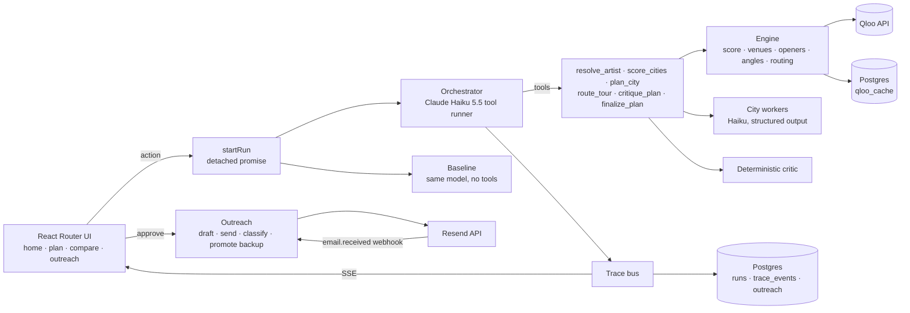

# Tourbo

> **Give it an artist. It plans the tour that sells out (cities, venues, openers) and emails the venues.**

Qloo Agentic Hackathon 2026 entry. Live demo: _link added at deploy_ (Render free tier: the first request after idle can take ~1 min).

Indie artists and their managers route tours by gut feel: last tour's cities, streaming counts, what a booking agent remembers. Streams show where someone listened once, not where people who'd buy a ticket cluster, which neighbourhood they're in, or which room fits them. A wrong city costs a half-empty room and a lost guarantee.

Tourbo is an agent that plans the tour from Qloo's taste graph and street-level fan heatmaps, shows its work live, and then books it.

## What it does

1. **Input:** artist (autocomplete from Qloo), region (North America or India), home base, start date, number of shows, room size.
2. **The agent works, with a live trace:**
   - scores every seed city in the region from the artist's Qloo heatmap (fan footprint + over-indexing), and finds the fan hotspots in each
   - plans the strongest cities in parallel: venues near the top hotspot (Qloo place insights, with a self-repairing search), a local opener (similar artists with heatmap presence in that city), and the city's culture
   - a per-city worker picks a venue + backup, estimates capacity (labelled: Qloo has no capacity field) and writes a promo angle; every claim cites a Qloo item or number
   - routes the tour (nearest neighbour + 2-opt, drive / fly days, days off)
   - a deterministic critic checks evidence, thin data, capacity fit and long legs; the agent fixes what it can (max 2 rounds)
3. **Output:** a map with the route, numbered stops and fan hotspots, plus a card per city: score, venue + backup, opener, promo angle and evidence chips.
4. **Qloo on vs off:** the same model plans the same tour with no tools. Both plans are scored with the run's Qloo city scores, and cities only one plan picked are highlighted.
5. **Outreach:** drafts a booking inquiry per venue (with the fan numbers), you review and approve, it sends (sandbox inbox only), classifies replies (interested / hold / pass) and on a pass promotes the backup venue and drafts a new inquiry. A pipeline board tracks it all; a "simulate reply" button drives the same handler as the real inbound webhook.

Every plan has a shareable read-only link (`/plan/<id>`).

## Why it fails without Qloo

An LLM alone can name "big music cities". It can't tell you where *this* artist's fans cluster block by block, which rooms near them that crowd likes, or which local acts share the audience. The compare tab shows it: for Arijit Singh (6 shows, India) the LLM-only plan picked Delhi (score 43) and Chennai (34), while the Qloo plan found Ahmedabad (54) and Hyderabad (61) and every venue and opener is a real Qloo entity with affinity numbers. Mean city score 73 vs 66; 6 of 6 venues backed by Qloo data vs 0.

## How it uses Qloo

All calls are GET to the hackathon API with `X-Api-Key`, through one client (`server/core/qloo/client.server.ts`) with retries, concurrency 8, a parameter whitelist per `filter.type` (Qloo silently ignores unknown params, so we reject them first) and a Postgres response cache.

| Step | Call |
| --- | --- |
| Resolve artist | `/search?types=urn:entity:artist` |
| City scoring + fan hotspots | `/v2/insights` `filter.type=urn:heatmap`, `signal.interests.entities=<artist>`, `filter.location.query=<city>`, `output.heatmap.boundary=urn:geohash`. Affinity is percentile-normalised per request, so the score blends footprint (Σ affinity × popularity) with over-indexing (mean affinity rank) |
| Venues | `filter.type=urn:entity:place`, `filter.location=POINT(lon lat)` + radius at the top hotspot, `filter.tags=urn:tag:category:place:{live_music_venue,concert_hall,night_club,bar}`, artist signal. Repair chain: 1.5 → 3 → 6 km → geohash-4 → city, each step in the trace |
| Openers | `filter.type=urn:entity:artist` with the artist signal, filtered to acts no bigger than the headliner, ranked by heatmap presence in each city |
| Promo angles | fan taste (tags / brands / TV with the artist signal), city culture (`signal.location.query`), local spots (places weighted by the artist's fans) |

## Architecture



- One TypeScript app: React Router v8 (framework mode, SSR) on a custom Express server; core logic in `server/core/`, UI in `app/`.
- Agent: `@anthropic-ai/sdk` `toolRunner` with Zod tools, adaptive thinking (summaries go to the trace), prompt caching on a byte-stable system prompt, refusal / max_tokens checks. A full run costs about $0.015.
- Trace: every tool call, Qloo call, repair, critic finding and decision is persisted and streamed over SSE (replay from `Last-Event-ID`), so a share link shows the full reasoning.
- Map: MapLibre GL + OpenFreeMap tiles (no key).
- Email: Resend (send API + `email.received` webhook, svix signature verified). Demo sends go only to a sandbox inbox.

## Judging criteria

- **Technological implementation:** heatmaps with geohash boundaries, place insights with WKT location + tags, artist and cross-domain insights, all through a validated, cached, rate-limited client; an agent that drives a deterministic engine, parallel city workers with structured output, a critic loop, self-repairing searches, a persisted live trace, and inbound email handling that re-plans.
- **Design:** one flow from artist to booked holds: live trace next to the map, evidence chips on every pick, a compare tab and a pipeline board.
- **Potential impact:** a real buyer (independent artists, managers, promoters) and real money (tickets, guarantees, travel), replacing gut-feel routing and manual booking emails.
- **Quality of idea:** the plan is only possible with Qloo's taste + location data, and the Qloo-off comparison makes that visible.

## Run locally

Requires Node 22+ and Docker.

```bash
npm install
cp .env.example .env          # add QLOO_API_KEY and ANTHROPIC_API_KEY
docker compose up -d          # Postgres on 127.0.0.1:5433
npm run qloo:ping             # check the Qloo key
npm run dev                   # http://localhost:3000
```

Other commands: `npm run qloo:prewarm` (cache the demo artists), `npm run plan:demo -- "<artist>" [na|in] [shows]` (engine only, no LLM), `npm run agent:demo -- "<artist>" [na|in] [shows]` (full agent in the terminal), `npm run typecheck`, `npm run build && npm start`.

### Environment

| Variable | Required | Notes |
| --- | --- | --- |
| `QLOO_API_KEY` | yes | |
| `QLOO_BASE_URL` | no | default `https://hackathon.api.qloo.com` |
| `ANTHROPIC_API_KEY` | yes | |
| `DATABASE_URL` | no | default: the compose Postgres |
| `RESEND_API_KEY` | no | without it, sends are simulated |
| `RESEND_WEBHOOK_SECRET` | no | `whsec_…`, for `POST /webhooks/email` |
| `OUTREACH_REPLY_DOMAIN` | no | Resend receiving domain; replies go to `reply+<token>@<domain>` |
| `OUTREACH_FROM` / `OUTREACH_INBOX` | no | sender and sandbox inbox (default `delivered@resend.dev`) |

### Deploy

`render.yaml` defines one Docker web service (health check `/healthz`) and a free Postgres. Set the keys in the Render dashboard.

## Limits

- Capacities are LLM estimates from the venue name and description (Qloo has no capacity field) and are always labelled.
- Venue data is thinner in some cities (hotel banquet halls appear in India); the worker excludes obvious misfits and lists why.
- Runs are in-process: a server restart mid-run shows "interrupted" with a retry button.

## License

MIT. Qloo responses are cached server-side only and never committed.
